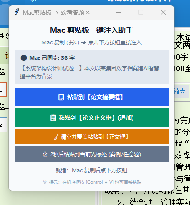

# ⚡ 软考机考跨系统剪贴板注入助手 (Ruankao Clipboard Bridge)

<p align="center">
  
</p>

<p align="center">
  <strong>专为 Mac + 虚拟机备考软考（系统分析师 / 系统架构设计师 / 信息系统项目管理师等）考生打造的跨系统剪贴板实时同步与论文一键注入神器。</strong>
</p>

<p align="center">
  <a href="./LICENSE"></a>
  <a href="https://www.python.org/"></a>
  <a href="https://github.com/commingling/ruankao-clipboard-bridge"></a>
</p>

---

## 🎯 痛点直击：为什么 Mac 考生无法在机考模拟系统中复制粘贴？

在 Mac 上通过虚拟机（如 **Parallels Desktop** 或 **VMware Fusion**）运行官方软考机考模拟系统（`ExamClient.exe`）时，普遍会遭遇以下四个令人抓狂的问题：

1. **禁用鼠标右键**：
   软考机考系统为防作弊，彻底禁用了答题编辑框（Delphi `TRichViewEdit`）的鼠标右键上下文菜单，无法右键点击“粘贴”。
2. **按键映射陷阱（`⌘V` 变成 `Win+V`）**：
   Mac 用户习惯按下 `⌘ Command + V` 进行粘贴。但在虚拟机中，Mac 的 `⌘ Command` 键默认映射为 Windows 的 `Win 徽标键`。按下 `⌘V` 实际向 Windows 发送的是 **`Win + V`**（弹出 Windows 剪贴板历史浮窗），不仅无法粘贴，还会打断输入焦点！
3. **虚拟机跨系统共享剪贴板偶发失灵**：
   Parallels / VMware 的宿主机与客机剪贴板同步经常发生延迟、格式丢弃或无响应假死。
4. **论文机考排版练习成本极高**：
   软考论文要求 2000~2500 字，在备考阶段若无法快速将 Mac 笔记中整理好的范文贴入机考答题框，就无法真实感受机考系统的换行、字数统计与分段排版效果。

**本工具正是为彻底根治这一系列痛点而生！**

---

## ✨ 特性亮点

- **⚡ 毫秒级双端自动桥接**：在 Mac 上选中任何文本按 `⌘C`，守护进程 0.3 秒内同步至虚拟机，Windows 系统剪贴板自动刷新。
- **🎯 精准识别机考答题框**：利用 Windows UIAutomation 自动化技术，精准定位 Delphi 核心答题区，自动区分 **【论文摘要框】**（~111px）与 **【论文正文框】**（~1036px），点击直接命中输入区域正中央。
- **🧹 多种注入模式**：
  - `📋 粘贴到【论文摘要框】`
  - `📋 粘贴到【论文正文框】(追加)`
  - `🧹 清空并覆盖粘贴到【论文正文框】`
- **⏱️ 2 秒延时通用粘贴**：针对**案例分析**等任意非论文题型，点击后提供 2 秒倒计时，让你有充裕时间将光标点进任意作答格，倒计时结束自动填入。
- **🪟 极简置顶小浮窗**：常驻虚拟机屏幕左上角，实时显示 Mac 剪贴板字数及文本预览，状态一目了然。
- **⌨️ 纯键盘友好**：后台同步已自动刷新 Windows 剪贴板，在机考框内直接按下键盘左下角的 **`Control + V`** 亦可原生粘贴。

---

## 🏗️ 架构与运行原理

```mermaid
flowchart LR
    subgraph macOS [macOS 宿主机]
        A["复制文本 (⌘C)"] --> B["pbpaste 剪贴板监听"]
        B --> C["共享桥接通道 (.mac_clipboard.txt)"]
    end

    subgraph WindowsVM [Windows 虚拟机 (Parallels / VMware)]
        C --> D["Windows 注入助手 (Tkinter 悬浮窗)"]
        D -->|自动同步| E["Windows 系统剪贴板"]
        D -->|一键注入| F["uiautomation 控件定位"]
        F --> G["软考机考系统 (TRichViewEdit)"]
        E -.->|Control + V 键盘直贴| G
    end
```

---

## 🚀 快速开始

### 1. 克隆本仓库

在 Mac 终端中克隆：
```bash
git clone https://github.com/commingling/ruankao-clipboard-bridge.git
cd ruankao-clipboard-bridge
```

---

### 2. Mac 端：启动剪贴板守护

在 Mac 终端运行：
```bash
chmod +x mac/start_mac.sh
./mac/start_mac.sh
```
看到输出 `🚀 软考机考 Mac 剪贴板跨系统守护进程已启动` 即可保持终端运行或后台挂起。

---

### 3. Windows 虚拟机端：启动注入助手

1. 确保虚拟机与 Mac 共享了桌面或主目录（Parallels 默认共享 `\\Mac\Home\Desktop`）。
2. 在虚拟机内打开本项目的 `windows` 目录。
3. 双击运行 **`start_win.bat`**。
   - 脚本会自动检测 Python 环境；
   - 首次运行若缺少 `uiautomation` 会自动通过国内源快速安装；
   - 启动后屏幕左上角将出现置顶悬浮助手。

---

### 4. 享受丝滑粘贴体验！

1. 在 Mac 上的任意笔记软件（Obsidian、Typora、VS Code 等）选中论文内容，按 **`⌘C`**。
2. 切到 Windows 虚拟机：
   - 浮窗即刻更新：`🟢 Mac 已同步: 2180 字` 并显示内容预览。
3. **点击按钮一键填入**：
   - 点击 `📋 粘贴到【论文摘要框】`
   - 点击 `📋 粘贴到【论文正文框】`
   - 做案例题时点击 `⏱️ 2秒后粘贴到当前光标处` 并在 2 秒内点进答题框。

---

## 💡 踩坑与常见问题 (FAQ)

### Q1：为什么我在虚拟机里按键盘 `Command + V` 弹出了剪贴板历史？
**A**：在 Mac 键盘上，`Command (⌘)` 键被虚拟机映射为 Windows 的 `Win 徽标键`。
因此：
- 按 `⌘ + V` ＝ `Win + V`（触发 Windows 剪贴板历史面板）。
- **正确按键方式**：按下 Mac 键盘最左下角的 **`Control` 键 + `V`**，即可直接粘贴。

### Q2：提示“未找到机考作答窗口”怎么办？
**A**：请确认已在机考练习系统中进入了具体的题目作答界面（窗口类名为 `TfrmMainCenter`）。若处于登录或试卷选择界面，先进入答题界面即可。

### Q3：如果共享路径不同，如何自定义共享文件路径？
**A**：
- **Mac 端**：支持指定文件参数：`python3 sync_mac_clipboard.py -f /path/to/shared/file.txt`
- **Windows 端**：默认会自动扫描 `\\Mac\Home\Desktop`、`C:\Mac\Home\Desktop`、当前目录及上级目录。也可直接在 `ruankao_paste_assistant.py` 中修改 `MAC_CLIP_FILE` 变量。

---

## 📄 开源协议

本项目采用 [MIT 许可证](./LICENSE)。欢迎各位考友 Star ⭐️、提 Issue 或 PR！祝各位软考高项、系分、架构考生顺利通关！🎉
